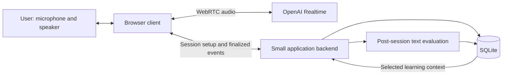

# Voxa: personal voice learning companion

Status: proposed design; implementation has not started.

Research date: October 16, 2026.

This document describes a single-user MVP. API capabilities and published rates are sourced below. Product behavior, retention periods, latency targets, and component choices are proposals. No voice sessions, latency benchmarks, model-quality evaluations, or end-to-end cost measurements have been run.

## 1. Product goal

Voxa helps the user learn and express ideas through spoken conversation. The primary interaction is **audio in and audio out**: the user speaks, hears a reply, asks follow-up questions, and can interrupt the assistant. Reading and typing should be optional during a session.

The initial learning modes are:

- **Teach-back:** the user explains a concept; Voxa identifies gaps, tests assumptions, and asks focused follow-up questions.
- **Mock interview:** Voxa asks interview questions, waits for the user's answer, and challenges trade-offs. Detailed assessment comes after the interview rather than interrupting every answer with tutoring.
- **English expression:** the user speaks Mandarin, English, or a mixture; Voxa offers a natural English expression and invites the user to practice it.
- **Guided learning:** Voxa teaches through short questions, examples, and exercises, adapting to the user's responses.

Across modes, favor concise spoken replies, one question at a time, time to think, and explicit uncertainty. The user should be able to request Mandarin explanations, another attempt, or a harder question by voice. A mode selector provides a predictable fallback.

## 2. Scope and assumptions

The MVP assumes one user, an internet connection, and a laptop browser with a microphone and speaker or headphones. Phone browser support is an early experiment, not a promise of reliable locked-screen operation.

Include:

- Start/end, mute, interruption handling, connection status, and a manual end-of-turn control.
- The four learning modes and Mandarin-English conversation.
- Optional transcript display, session review, and selected learning memory.
- Per-session usage records and application-controlled session budgets.

Defer hardware integration, continuous always-on listening, offline inference, multi-user accounts, subscriptions, a learning-management system, and calibrated pronunciation or mastery scores. Cross-device use and background mobile audio may require a later deployment or native client decision.

## 3. Architecture decision

**Start with OpenAI Realtime speech-to-speech over WebRTC.** One model handles audio understanding, conversational reasoning, and spoken responses. This is a good fit for validating whether the companion feels useful in conversation.

Alternatives remain open:

- A speech-recognition → text-model → speech-synthesis pipeline makes intermediate text inspectable and each component replaceable. It adds coordination work for streaming, cancellation, and interruptions; it could become attractive if measured cost or reasoning-control requirements justify it.
- GPT-Live separates the spoken interaction from a delegated reasoning backend and supports conversation while that backend works. Revisit it if concurrent conversation and substantial backend reasoning become a central requirement.

These are distinct architectures with different billing and state behavior. They should not be treated as interchangeable model settings. See the [official voice architecture comparison](https://developers.openai.com/api/docs/guides/voice-agents).

### Proposed components

- **React/TypeScript client:** microphone controls, playback, session state, mode, captions, and review UI.
- **Node/TypeScript backend:** permanent API key, temporary session credentials, persistence, context selection, usage accounting, and review execution.
- **SQLite:** sufficient for one user's sessions, transcript turns, learning notes, and metadata. No vector database or distributed cache is proposed initially.
- **Post-session evaluator:** a separate text-model request for structured feedback and proposed learning-note updates. Choose its model through evaluation rather than assuming a particular model is necessary.

The browser sends audio directly to OpenAI. The backend need not proxy the audio stream. Permanent API credentials stay on the server; the browser receives short-lived credentials. A server sideband connection can later capture events and execute private tools without routing primary audio through the backend. Sources: [WebRTC](https://developers.openai.com/api/docs/guides/voice-webrtc), [server-side controls](https://developers.openai.com/api/docs/guides/voice-server-controls).

Use the Realtime SDK as a possible session-management wrapper; retain explicit application ownership of persistence and learning behavior. No additional orchestration framework is needed for the proposed MVP.

## 4. Session lifecycle

1. The user chooses a mode and optionally a topic, then starts the session.
2. The backend loads preferences and a small set of relevant learning notes and issues session credentials.
3. The client requests microphone access and establishes WebRTC. Show listening only after the connection is ready.
4. The user and Voxa converse. Transcript collection and persistence proceed independently of spoken response generation.
5. On end, finalize received transcript items and usage, then close the media connection and release the microphone.
6. Run post-session review asynchronously. Show pending, complete, or failed review status; a failed review must not discard the session.
7. On a future session, load selected context rather than the entire conversation archive.

Distinguish muted, disconnected, and ended states. Muting the microphone is not the same as ending the session. On network failure, stop claiming that Voxa is listening and offer reconnection. A replacement session can receive a compact summary and recent finalized turns, with an explicit indication that continuity may be incomplete.

The documented Realtime session maximum is 60 minutes. Plan continuation at a natural boundary before that limit, using persisted context. Do not assume a new connection restores the old conversation automatically. [Session lifecycle](https://developers.openai.com/api/docs/guides/realtime-conversations)

## 5. Latency and turn-taking

Measure two user-visible behaviors separately:

- Time from the user's last spoken word to the first audible assistant response.
- Time from the user beginning an interruption to assistant playback stopping.

Also record detected turn end, first response/audio events, and client playback start. This separates turn-detection waiting from remaining model, network, and playback delays. Streaming stages overlap, so individual timings should not be blindly added together.

Initial product targets for ordinary conversation are a median last-word-to-reply delay of at most 1.5 seconds, a 95th percentile of at most 3 seconds, and a 95th-percentile interruption stop delay of at most 300 milliseconds. These are acceptance targets, not published provider guarantees or measured results. Deep reasoning and deliberately patient turn-taking need separate reporting.

### Proposed turn policy

- Teach-back and interviews: begin with semantic voice activity detection (VAD) at low eagerness.
- Short English practice: begin with medium eagerness.
- Provide a manual “done speaking” control for pauses that automatic detection handles poorly.
- Allow interruptions and keep replies short enough that the user remains an active participant.

Semantic VAD estimates completion using the meaning of speech; silence-based VAD uses pauses. Lower eagerness allows more time to speak. Neither can guarantee that a thinking pause means the user is finished. Test with the user's actual speech patterns. [VAD documentation](https://developers.openai.com/api/docs/guides/realtime-vad)

Keep comprehensive grading, memory extraction, and unnecessary database reads outside the spoken response path. Preload relevant learning context at session start. Allow a slower, acknowledged check when technical correctness requires it. Higher reasoning effort can increase latency and output token usage. [Realtime model documentation](https://developers.openai.com/api/docs/models/gpt-realtime-2.1)

## 6. Model choice and cost

Use the full Realtime model as a quality reference, then compare Mini on identical tasks. Mini is the proposed everyday default only if it meets requirements for misconception detection, bilingual understanding, and coaching behavior. A cheaper model that confidently validates incorrect explanations would undermine the product.

Published audio rates, USD per million tokens:

- **gpt-realtime-2.1-mini:** new input $10; cached input $0.30; output $20.
- **gpt-realtime-2.1:** new input $32; cached input $0.40; output $64.

At approximately 600 user audio tokens and 1,200 assistant audio tokens per speech minute, the fresh-audio baseline for 30 minutes of user speech plus 30 minutes of assistant speech is **$0.90 Mini** or **$2.88 full**. At 30 minutes daily for 30 days, assuming equal speaking time and no silence, this becomes **$13.50 Mini** or **$43.20 full**.

These are arithmetic baselines, not complete invoice forecasts. Each response can process prior conversation context; later turns can therefore cost more. Input transcription, when enabled, has a separate charge. Include text/reasoning usage, evaluation, tools, and hosting as applicable. Cache reuse is best-effort. Sources: [pricing](https://developers.openai.com/api/docs/pricing), [voice cost accounting](https://developers.openai.com/api/docs/guides/voice-latency-cost).

For comparison, GPT-Live voice duration is currently $0.05 per active minute, or $45 for 900 monthly minutes, plus backend usage. Its duration billing includes silence and backend waiting. This estimate must not be substituted for Realtime token billing. [Pricing](https://developers.openai.com/api/docs/pricing), [duration accounting](https://developers.openai.com/api/docs/guides/voice-latency-cost)

### Usage accounting and controls

Persist response-level usage with the model, prompt version, session ID, and a versioned rate card. Price uncached and cached input separately; do not charge cached tokens again as uncached input. Reconcile reported reasoning usage according to the selected model's accounting rather than adding it twice.

Track transcription and evaluator usage separately. Record interrupted/cancelled responses too; audio heard by the user is not a sufficient billing measure. Report incomplete usage as incomplete rather than zero.

Provide a configurable session duration and estimated-spend threshold, and close sessions when the user ends them. Application checks limit exposure but should not promise an exact invoice cutoff: in-flight work and delayed usage reporting can create an overshoot.

Compare 5-, 15-, and 45-minute sessions, cost per useful learning session, and cache behavior. Do not extrapolate a complete monthly bill from one short exchange.

## 7. Conversation storage and learning memory

Persistent storage is not required for an isolated voice conversation. It is useful for session review, next-day continuity, debugging feedback, and tracking what to practice.

Proposed defaults:

- **Finalized transcript turns:** 30 days, with explicit pinning for sessions worth keeping.
- **Session summaries and learning notes:** until removed or superseded.
- **Usage and timing metadata:** 90 days.
- **Raw audio:** off by default; retain only explicitly selected clips for replay or pronunciation work.

Transcripts support wording and conceptual feedback. A transcript cannot preserve pronunciation or intonation evidence; those features require audio and separate quality evaluation. Do not present pronunciation scores as calibrated measurements.

### Minimal conceptual records

- **Session:** ID, mode, topic, start/end, model, prompt version, connection outcome, and review status.
- **Turn:** provider item ID, speaker, ordering relationship, finalized text, timestamps, and interruption/incomplete markers.
- **Review:** summary, strengths, possible misconceptions, useful English expressions, suggested exercises, and supporting turn IDs.
- **Learning note:** topic, observation, source session/turn IDs, tentative/resolved status, last-reviewed date, and suggested next practice.
- **Usage:** response ID, token categories and cache details, separate transcription/evaluation usage, estimated cost, and accounting completeness.

Treat a learning note as evidence-backed guidance, not an unquestionable fact about the user. Distinguish a direct statement from evaluator inference. Allow correction and removal. An uncertain transcript must not silently become a permanent weakness label.

### Persistence behavior

Save finalized turns incrementally; do not wait until session end to save everything. Match events by item ID and preserve conversation ordering rather than assuming arrival order. Deduplicate retries. Partial transcript text is a display aid until finalized, and incomplete sessions remain reviewable with that limitation marked.

With interruptions, preserve what was actually played and mark interrupted output. WebRTC automatically truncates unplayed assistant audio from the live conversation, so the archive must reconcile its transcript rather than treating all generated output as heard. [Interruption handling](https://developers.openai.com/api/docs/guides/realtime-conversations)

For the initial client-forwarded persistence design, buffer unsaved finalized events for retry and expose unsaved state. Browser closure can still lose unsent data. If this proves unacceptable, use server-side event capture; do not claim crash-proof storage from client forwarding alone.

Run review only on a clearly identified transcript snapshot. Store review status and make retries idempotent. A simple backend task is enough initially; a separate queue service is not required by this design.

## 8. Caching and context management

Keep three concepts distinct:

- **Provider prompt cache:** reuses computation for a matching input prefix. It is a cost/latency optimization, not durable user memory.
- **Application learning memory:** stores selected observations and evidence across sessions.
- **Cached answers/audio:** replays earlier output. Reserve this for fixed prompts or deliberate practice clips; personalized coaching depends on current context.

Keep stable instructions and tool definitions at the beginning. Append turns rather than rewriting earlier history. Avoid changing the prompt prefix every turn with timestamps or refreshed summaries. Summarization and truncation can reduce cache reuse. Dropping old context in batches can reduce repeated cache misses, but loses more history at once. [Realtime prompt caching](https://developers.openai.com/cookbook/examples/prompt_caching_201)

Proposed context policy:

1. At session start, select preferences, the current topic summary, and a small number of relevant learning notes.
2. Retain recent dialogue for natural follow-ups.
3. Summarize at topic boundaries or when the token budget requires it.
4. Preserve useful older information before discarding old context.
5. Keep the full retained archive outside the live model context.

Experiment with a 16k post-instruction token budget and retention ratio 0.8, compared with 8k and 32k. These values are starting hypotheses, not requirements. Test forgetting and feedback quality alongside cost. The API exposes a custom conversation-token limit and retention-ratio truncation. [Configuration reference](https://developers.openai.com/api/reference/resources/realtime/subresources/client_secrets/methods/create)

For initial memory selection, use explicit topic tags and SQLite search. Add embeddings only if retrieval failures demonstrate a need. Do not rely on an assumed cache lifetime for cross-day continuity; the application owns that memory.

## 9. Privacy and deletion

Offer a session without persistent transcript storage or learning updates. Explain that speech still goes to the API provider. Avoid logging credentials or raw audio in ordinary diagnostic logs.

Deleting a session should remove its transcript, retained clips, review, and dependent learning notes, or recompute notes that have independent supporting evidence. Pinned sessions need an explicit deletion path too.

Application retention and provider retention are separate. OpenAI states that API data is not used for training by default. Standard abuse-monitoring logs may contain content and are generally retained for up to 30 days, with documented exceptions. Special retention controls require eligibility and approval; this MVP must not claim zero provider retention. [Data controls](https://developers.openai.com/api/docs/guides/your-data)

## 10. Validation before implementation commitments

The first paid prototype should answer a small set of concrete questions:

- **Model quality:** can Mini and full detect the same deliberately incorrect technical explanations without agreeing too readily?
- **Turn-taking:** can the user pause, say “um,” switch languages, and explain a concept for several minutes without premature replies?
- **English coaching:** does Voxa preserve intended meaning and provide natural expressions rather than literal translations?
- **Latency:** do ordinary replies and interruption handling meet targets across laptop speakers and headphones?
- **Long sessions:** how do cost, cached input, and recall change at 5, 15, and 45 minutes?
- **Recovery:** do disconnection, microphone denial, interrupted output, duplicate events, and failed review produce understandable states?
- **Memory:** can the next session revisit a supported learning gap, and can the user correct or delete it?
- **Mobile:** do foreground use, screen locking, Bluetooth routing, and reconnection meet the desired hands-free experience?

Use identical tasks and prompts when comparing models. Keep a small human-reviewed set of explanations and feedback examples. Evaluate learning quality separately from transcript accuracy and conversational smoothness. No result is established by this document.

## 11. Open decisions

- Preferred session length and monthly testing budget.
- Whether teach-back or English expression should be the first mode evaluated.
- Whether the proposed 30-day transcript retention is useful, or sessions should default to no persistence.
- Whether phone foreground use is sufficient for the MVP, or locked-screen use is a launch requirement.
- How much technical checking should happen during conversation versus after the session.
- Whether client-forwarded event persistence is adequate, or server capture is needed from the first prototype.

These decisions can be resolved before implementing their dependent features. This document does not authorize implementation or paid experiments.
