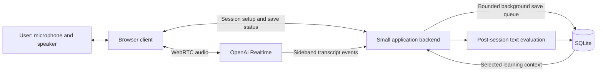

# Voxa: personal voice learning companion

Status: the local voice MVP is implemented with optional transcript persistence and a saved-conversation viewer. Worker storage, normalization, and failure isolation have offline checks; real sideband/transcription acceptance remains pending. The user accepted the original voice MVP. Continuity summaries and automatic recent-history startup context are implemented, with spoken acceptance pending. Learning modes and automatic rollover remain planned. See PLANS.md for verification boundaries.

Research date: October 16, 2026.

Documentation review: October 16, 2026. See the review entry in [PLANS.md](PLANS.md) for corrections and verification limits.

This document describes a single-user MVP. API capabilities and published rates are sourced below. Product behavior, retention periods, latency targets, and component choices are proposals. User-reported voice use is recorded in PLANS.md; no controlled latency benchmarks, model-quality evaluations, or end-to-end cost measurements have been run.

## 1. Product goal

Voxa helps the user learn and express ideas through spoken conversation. The primary interaction is **audio in and audio out**: the user speaks, hears a reply, asks follow-up questions, and can interrupt the assistant. Reading and typing should be optional during a session.

The initial learning modes are:

- **Teach-back:** the user explains a concept; Voxa identifies gaps, tests assumptions, and asks focused follow-up questions.
- **Mock interview:** Voxa asks interview questions, waits for the user's answer, and challenges trade-offs. Detailed assessment comes after the interview rather than interrupting every answer with tutoring.
- **English expression:** the user speaks Mandarin, English, or a mixture; Voxa offers a natural English expression and invites the user to practice it.
- **Guided learning:** Voxa teaches through short questions, examples, and exercises, adapting to the user's responses.

Across modes, favor concise spoken replies, one question at a time, time to think, and explicit uncertainty. The user should be able to request Mandarin explanations, another attempt, or a harder question by voice. A mode selector provides a predictable fallback.

## 2. Scope and assumptions

The MVP assumes one user, an internet connection, and a laptop browser with a microphone and speaker or headphones. Phone browser support is an early experiment, not a promise of reliable locked-screen operation.

Include:

- Start/end, mute, interruption handling, connection status, and a manual end-of-turn control.
- The four learning modes and Mandarin-English conversation.
- Optional transcript display, session review, and selected learning memory.
- Per-session usage records and application-controlled session budgets.

Defer hardware integration, continuous always-on listening, offline inference, multi-user accounts, subscriptions, a learning-management system, and calibrated pronunciation or mastery scores. Cross-device use and background mobile audio may require a later deployment or native client decision.

## 3. Architecture decision

**Start with OpenAI Realtime speech-to-speech over WebRTC.** One model handles audio understanding, conversational reasoning, and spoken responses. This is a good fit for validating whether the companion feels useful in conversation.

Alternatives remain open:

- A speech-recognition → text-model → speech-synthesis pipeline makes intermediate text inspectable and each component replaceable. It adds coordination work for streaming, cancellation, and interruptions; it could become attractive if measured cost or reasoning-control requirements justify it.
- GPT-Live separates the spoken interaction from a delegated reasoning backend and supports conversation while that backend works. Revisit it if concurrent conversation and substantial backend reasoning become a central requirement.

These are distinct architectures with different billing and state behavior. They should not be treated as interchangeable model settings. See the [official voice architecture comparison](https://developers.openai.com/api/docs/guides/voice-agents).

### Proposed components

- **React/TypeScript client:** microphone controls, playback, session state, mode, captions, and review UI.
- **Python/FastAPI backend:** permanent API key, temporary session credentials, persistence, context selection, usage accounting, and review execution.
- **SQLite:** sufficient for one user's sessions, transcript turns, learning notes, and metadata. No vector database or distributed cache is proposed initially.
- **Post-session evaluator:** a separate text-model request for structured feedback and proposed learning-note updates. Choose its model through evaluation rather than assuming a particular model is necessary.

The browser sends audio directly to OpenAI. The backend need not proxy the audio stream. Permanent API credentials stay on the server. Saved sessions use a one-use browser setup handle: the backend exchanges SDP with its own temporary credential and obtains the call ID directly from the provider response before attaching the sideband observer. This avoids accepting an arbitrary client-selected call ID. Sessions with saving off use a temporary browser credential when there is no history; when history is present they use a transient backend setup handle without a transcript observer or content writes. Both use direct WebRTC for ongoing audio. The sideband observes the same Realtime session, not a second AI conversation or a separate Codex chat. Sources: [WebRTC](https://developers.openai.com/api/docs/guides/voice-webrtc), [server-side controls](https://developers.openai.com/api/docs/guides/voice-server-controls?voice-api=realtime).

Voice and persistence are separate asynchronous tasks within the application. Neither database acknowledgments nor transcript finalization should gate microphone transport, playback, or response generation. The implementation uses a dedicated Python worker thread for the synchronous standard-library SQLite API, keeping database locks off the API/event loop. Calling a blocking database operation from an async function does not make it nonblocking.

Use the Realtime SDK as a possible session-management wrapper; retain explicit application ownership of persistence and learning behavior. No additional orchestration framework is needed for the proposed MVP.

### Python and provider boundaries (October 17 migration)

The repository groups web source/npm tooling under `frontend/` and Python source/uv tooling/environment/data under `backend/`, with root `Makefile` commands. The implementation separates the FastAPI HTTP contract, application services, SQLite repository, model-provider adapters and local-app connectors. VoiceProvider and SummaryProvider are independent ports; OpenAI is the initial concrete implementation. Provider-specific credential formats, URLs, request schemas, sideband connections and transcript wire normalization stay in that adapter. Browser protocol details live in a matching transport adapter. A provider with a different audio transport requires an additional browser adapter; changing an environment variable alone is insufficient. No orchestration framework, extra service, vector database or distributed queue is added.

BrainShuffle remains an independent application. An optional loopback HTTP connector reads its actual `/api/problems/{id}` schema, and a versioned Voxa export prepares the return-data boundary. No database sharing, automatic summary upload or grading is introduced. The existing UI behavior and schema-v4 archive remain the migration baseline. See [PYTHON_BACKEND.md](PYTHON_BACKEND.md) for the concrete parity contract and extension workflow.

## 4. Session lifecycle

1. The user chooses a mode and optionally a topic, then starts the session.
2. The backend loads preferences and a small set of relevant learning notes and issues session credentials.
3. The client requests microphone access and establishes WebRTC. Show listening only after the connection is ready.
4. The user and Voxa converse. Transcript collection and persistence proceed independently of spoken response generation.
5. On end, stop microphone capture and playback immediately, cancel active generation, and allow only a bounded drain of final events before closing the connection. Missing final transcript or usage data remains explicitly incomplete; saving must not delay microphone release.
6. For saved sessions, review an identified transcript revision asynchronously. Show pending, complete, or failed review status; a failed review must not discard the session. Late finalized events create a new revision and invalidate stale reviews rather than silently changing their evidence.
7. On a future session, load selected context rather than the entire conversation archive.

Distinguish muted, disconnected, and ended states. Muting the microphone is not the same as ending the session. On network failure, stop claiming that Voxa is listening and offer reconnection. A replacement session can receive a compact summary and recent finalized turns, with an explicit indication that continuity may be incomplete.

The documented Realtime session maximum is 60 minutes. Plan continuation at a natural boundary before that limit, using persisted context. Do not assume a new connection restores the old conversation automatically. [Session lifecycle](https://developers.openai.com/api/docs/guides/realtime-conversations)

## 5. Latency and turn-taking

Measure two user-visible behaviors separately:

- Time from the user's last spoken word to the first audible assistant response.
- Time from the user beginning an interruption to assistant playback stopping.

Also record detected turn end, first response/audio events, and client playback start. This separates turn-detection waiting from remaining model, network, and playback delays. Streaming stages overlap, so individual timings should not be blindly added together.

Initial product targets for ordinary conversation are a median last-word-to-reply delay of at most 1.5 seconds, a 95th percentile of at most 3 seconds, and a 95th-percentile interruption stop delay of at most 300 milliseconds. These are acceptance targets, not published provider guarantees or measured results. Deep reasoning and deliberately patient turn-taking need separate reporting.

### Proposed turn policy

- Teach-back and interviews: begin with semantic voice activity detection (VAD) at low eagerness.
- Short English practice: begin with medium eagerness.
- Provide a manual “done speaking” control for pauses that automatic detection handles poorly.
- Allow interruptions and keep replies short enough that the user remains an active participant.

The manual fallback is an explicit interaction mode, not an extra button layered over automatic replies. It must gate automatic response creation and trigger one response only when the user indicates completion. Test switching between automatic and manual policies without duplicate replies. Prompting the assistant to wait is not a reliable substitute for response gating.

Semantic VAD estimates completion using the meaning of speech; silence-based VAD uses pauses. Lower eagerness allows more time to speak. Neither can guarantee that a thinking pause means the user is finished. Test with the user's actual speech patterns. [VAD documentation](https://developers.openai.com/api/docs/guides/realtime-vad)

Keep comprehensive grading, memory extraction, and unnecessary database reads outside the spoken response path. Preload relevant learning context at session start. Allow a slower, acknowledged check when technical correctness requires it. Higher reasoning effort can increase latency and output token usage. [Realtime model documentation](https://developers.openai.com/api/docs/models/gpt-realtime-2.1)

## 6. Model choice and cost

Use the full Realtime model as a quality reference, then compare Mini on identical tasks. Mini is the proposed everyday default only if it meets requirements for misconception detection, bilingual understanding, and coaching behavior. A cheaper model that confidently validates incorrect explanations would undermine the product.

Run a small model-quality comparison after the voice foundation and first two learning modes, before building persistent learning memory. Repeat a broader comparison later for long sessions. A poor conversational foundation should change the design early.

Published audio rates, USD per million tokens:

- **gpt-realtime-2.1-mini:** new input $10; cached input $0.30; output $20.
- **gpt-realtime-2.1:** new input $32; cached input $0.40; output $64.

At approximately 600 user audio tokens and 1,200 assistant audio tokens per speech minute, the fresh-audio baseline for 30 minutes of user speech plus 30 minutes of assistant speech is **$0.90 Mini** or **$2.88 full**. At 30 minutes daily for 30 days, assuming equal speaking time and no silence, this becomes **$13.50 Mini** or **$43.20 full**.

These are arithmetic baselines, not complete invoice forecasts. Each response can process prior conversation context; later turns can therefore cost more. Input transcription, when enabled, has a separate charge. Include text/reasoning usage, evaluation, tools, and hosting as applicable. Cache reuse is best-effort. Sources: [pricing](https://developers.openai.com/api/docs/pricing), [voice cost accounting](https://developers.openai.com/api/docs/guides/voice-latency-cost).

For comparison, GPT-Live voice duration is currently $0.05 per active minute, or $45 for 900 monthly minutes, plus backend usage. Its duration billing includes silence and backend waiting. This estimate must not be substituted for Realtime token billing. [Pricing](https://developers.openai.com/api/docs/pricing), [duration accounting](https://developers.openai.com/api/docs/guides/voice-latency-cost)

### Usage accounting and controls

Persist response-level usage with the model, prompt version, session ID, and a versioned rate card. Price uncached and cached input separately; do not charge cached tokens again as uncached input. Reconcile reported reasoning usage according to the selected model's accounting rather than adding it twice.

Track transcription and evaluator usage separately. Record interrupted/cancelled responses too; audio heard by the user is not a sufficient billing measure. Report incomplete usage as incomplete rather than zero.

Provide a configurable session duration and estimated-spend threshold, and close sessions when the user ends them. Application checks limit exposure but should not promise an exact invoice cutoff: in-flight work and delayed usage reporting can create an overshoot.

Compare 5-, 15-, and 45-minute sessions, cost per useful learning session, and cache behavior. Do not extrapolate a complete monthly bill from one short exchange.

## 7. Conversation storage and learning memory

Persistent storage is not required for an isolated voice conversation. It is useful for session review, next-day continuity, debugging feedback, and tracking what to practice.

Current increment: the UI always saves transcripts automatically at the user's request; the redundant saving checkbox was removed. SQLite stores transcript turns under `data/`, with no raw-audio recording. The viewer supports concise titles with dates, refresh, per-row deletion with confirmation, and manual categories. Compact category headings have contextual rename/remove menus; + Category opens a small creation form. Dense history rows place titles and shortened dates together when space permits. The voice area contains controls and actionable status only; storage, memory and API usage details live in a collapsed footer section. One category groups related conversations in history; removing a category preserves its conversations. Category changes do not alter transcript revisions or summary evidence. Generic capture diagnostics are not displayed in the transcript viewer. A compact Summary paragraph reuses whole points from the current saved summary above the individual turns; diagnostic metadata remains internal and actual saving errors remain actionable. Expired transcript content is removed on history access after 30 days. Pinning, learning notes, and automatic model-session rollover are still proposals below; no-save sessions perform no conversation-content writes.

Deliver basic transcript saving before automatic learning-memory extraction. The archive preserves what was captured; the model knows past content only when the application explicitly supplies selected history or retrieval results. Saving turns does not train the model, automatically restore a new provider session, or require a learning-quality evaluator.

Proposed defaults:

- **Finalized transcript turns:** 30 days, with explicit pinning for sessions worth keeping.
- **Session summaries and learning notes:** until removed or superseded; retain only compact observations and minimal provenance after source-transcript expiry.
- **Usage and timing metadata:** 90 days.
- **Raw audio:** no recording feature in this MVP. Explicitly selected practice clips are a possible later feature.

Transcripts support wording and conceptual feedback. A transcript cannot preserve pronunciation or intonation evidence; those features require audio and separate quality evaluation. Do not present pronunciation scores as calibrated measurements.

### Minimal conceptual records

- **Session:** application ID, provider-session identities, mode, topic, start/end, model, prompt version, transcript revision, connection outcome, and review status.
- **Turn:** application ID, provider session/item identity, speaker, ordering relationship, finalized text, timestamps, and interruption/incomplete markers.
- **Review:** source transcript revision, summary, strengths, possible misconceptions, useful English expressions, suggested exercises, and supporting turn IDs.
- **Learning note:** topic, observation, source session/turn IDs, tentative/resolved status, last-reviewed date, and suggested next practice.
- **Usage:** response ID, token categories and cache details, separate transcription/evaluation usage, estimated cost, and accounting completeness.

Treat a learning note as evidence-backed guidance, not an unquestionable fact about the user. Distinguish a direct statement from evaluator inference. Allow correction and removal. An uncertain transcript must not silently become a permanent weakness label.

### Persistence behavior

Save finalized turns incrementally; do not wait until session end to save everything. Match events by item ID and preserve conversation ordering rather than assuming arrival order. Deduplicate retries. Partial transcript text is a display aid until finalized, and incomplete sessions remain reviewable with that limitation marked.

Input transcription is asynchronous and is an approximation of the audio, not exactly what the speech model understood. Preserve that distinction in review and memory. Use a bounded finalization deadline; a late event must not be attached to the wrong session or quietly alter a completed review. [Input transcription reference](https://developers.openai.com/api/reference/resources/realtime/subresources/client_secrets/methods/create)

Mark interrupted assistant output as incomplete. WebRTC truncates unplayed audio in live context, but the API does not supply a precisely aligned truncated transcript. Do not promise an exact record of words heard. Conservatively exclude uncertain assistant text from claims about delivered teaching, and retain an interruption marker instead. [Interruption handling](https://developers.openai.com/api/docs/guides/realtime-conversations)

### Capture and background saving

Prefer backend sideband capture for long conversations and walking use, reducing reliance on browser event forwarding. Associate the provider call with a server-issued application conversation before attaching. Keep the permanent key on the backend and verify ownership rather than accepting arbitrary client-supplied call IDs. The documented Realtime WebRTC flow exposes the call ID through the SDP response's `Location` header; verify registration and attachment with the actual browser when implementing. Attach early, and mark an attachment gap as incomplete rather than assuming past events will be replayed. A sideband does not keep the primary audio connection alive when the browser or network disconnects. [Realtime sideband connection](https://developers.openai.com/api/docs/guides/voice-server-controls?voice-api=realtime)

Use one owner for durable transcript writes. The browser may observe the same events for captions/status; it must not independently append duplicate turns. Client-forwarded capture remains a possible smaller fallback, with browser closure and unsent-event loss explicitly documented. Do not switch event owners silently during failures.

The proposed save flow is:

1. Receive transcript events and normalize speaker, item identity, ordering, finalization, and interruption state. Enable input transcription for saved sessions; do not route live replies through transcription. Transcription has separate usage charges.
2. Enqueue finalized turns or later revisions with a key containing application conversation, provider session, and item identity. Event callbacks do minimal work and never await a database commit before voice can proceed.
3. A background writer commits small transactions to SQLite and acknowledges saved revisions. Retry transient failures with bounded backoff; duplicate delivery must update the same record rather than append a second turn. Reject stale revisions and writes for deleted conversations.
4. Expose saving, saved, delayed, and incomplete status independently of voice connection state. Record bounded, sanitized capture reason codes and show saved-turn counts. Expected idle cancellation and an empty-buffer error correlated to our final End commit are cleanup outcomes; do not flag them as transcript loss. Unexpected provider errors and missing final text/order remain warnings. Preserve older unknown flags rather than guessing the cause. Sideband or database failure must not close an otherwise healthy voice session. Bound the queue by count/bytes and retry time; if limits are reached, mark a save gap and stop accepting additional content for persistence until recovery instead of growing memory without limit or silently claiming success.
5. On End, release microphone and playback immediately. A saved conversation remains alive independently of its voice state: show finalizing, accept late observer events for up to 12 seconds, and close the remaining client transport by 15 seconds. If input was still active, make a best-effort final input commit without requesting another model response. A completed empty ASR result is distinct from a missing final event; it can mean no speech was recognized, so it does not by itself create a pending-finalization warning. Keep placeholder records for detected but unfinished input turns, so a missing ASR completion cannot silently look like a complete capture. Finish saving already-received turns independently of transport closure. Late events stay bound to their original provider session, and deferred cleanup must never affect a new session. These deadlines are initial implementation choices, not measured ASR guarantees. Pending in-memory content can be lost on process failure; only committed data is durable. No-save sessions bypass the durable queue and content writes.

Verify this separation with slow/locked/unavailable storage, sideband loss, duplicate/out-of-order events, queue exhaustion, and End during a pending write. Compare spoken-response timing with saving enabled and disabled under an authorized bounded trial; architectural separation is not proof of zero latency impact. Do not claim complete transcripts when events are missing.

Persistence rollout must preserve an already-running conversation: do not refresh the browser, hot-reload its voice controller, or restart its services to install saving while the user is speaking. Enable capture on a fresh session after the current conversation ends. Previously unsaved speech cannot be recovered retroactively.

Run review only on a clearly identified transcript snapshot. Store review status and make retries idempotent. A simple backend task is enough initially; a separate queue service is not required by this design.

The current continuity increment (V25–V27) adds separate consumers of saved turns. After the durable End operation, a claimed SQLite summary job runs one at a time, using a 90-second deadline and at most three attempts. The job summarizes at most six 24,000-byte sections and one merge with `gpt-5.6-terra` (reasoning disabled); source references are validated and partial coverage is labeled. The same response produces a short title in the conversation’s main language, with source turn references and an 80-character cap. Multi-section jobs choose the final title in the existing merge request. Titles are revision-bound metadata in the summary JSON; they never replace transcript text. The background runner automatically queues ended untitled records, including legacy summaries, in batches of up to 100; an exhausted current job is never reset by polling. Listing history does not schedule work. A bounded opening excerpt labels a conversation immediately until its model title is ready; transcript text is unchanged. A new selected source revision invalidates earlier summary results. Summary failures never gate active voice. Summaries currently share their source's 30-day expiry/deletion policy; indefinitely retained learning notes below remain a future policy.

At Start, the backend automatically chooses the three most recent eligible ended conversations from the retained history. Ready summaries and recent finalized excerpts form a round-robin packet under 6,000 UTF-8 bytes. A pending/failed summary uses eligible excerpts without waiting for an LLM call. Each source gets a bounded excerpt before extra points fill the remaining budget; omission notices stay in the packet. The existing single-use five-minute reservation/revision checks protect startup, but no picker/preview UI is needed. Microphone tracks remain muted until the exact inserted context item receives `conversation.item.done`; errors or timeout release media. The injected item is excluded from new archival normalization. Sources cannot be deleted while setup or voice uses them, including sessions with saving off. Saving off now disables new content writes, not history loading, per the user's updated requirement. Permanent learning-memory inference remains a separate future feature. The API supports [inserting text history](https://developers.openai.com/api/reference/resources/realtime/client-events); summary output uses [Structured Outputs](https://developers.openai.com/api/docs/guides/structured-outputs?api-mode=responses), with application validation of source references.

Broader summarization and context restoration remain separate consumers of saved turns. Do not rewrite the active model context on each database commit. At a new session or deliberate continuation boundary, select a compact summary and recent finalized turns within a token budget, preserving uncertainty and source turn IDs. Earlier details can be retrieved by topic or SQLite text search. Do not inject the entire archive into every response.

Persist pending review work so a backend restart can retry it. Before committing a result, check the source revision and whether the session still exists. Deletion or expiry must invalidate affected in-flight jobs so their completion cannot recreate removed content. Treat transcript text as evidence, not as instructions to the evaluator.

## 8. Caching and context management

Keep three concepts distinct:

- **Provider prompt cache:** reuses computation for a matching input prefix. It is a cost/latency optimization, not durable user memory.
- **Application learning memory:** stores selected observations and evidence across sessions.
- **Cached answers/audio:** replays earlier output. Reserve this for fixed prompts or deliberate practice clips; personalized coaching depends on current context.

Keep stable instructions and tool definitions at the beginning. Append turns rather than rewriting earlier history. Avoid changing the prompt prefix every turn with timestamps or refreshed summaries. Summarization and truncation can reduce cache reuse. Dropping old context in batches can reduce repeated cache misses, but loses more history at once. [Realtime prompt caching](https://developers.openai.com/cookbook/examples/prompt_caching_201)

Proposed context policy:

1. At session start, select preferences, the current topic summary, and a small number of relevant learning notes.
2. Retain recent dialogue for natural follow-ups.
3. At a topic boundary or before the context threshold, build a compact summary from finalized, eligible turns.
4. Verify the summary and recent turns are available before intentionally replacing old context. Automatic truncation alone does not summarize discarded content. If it occurs first, mark the gap and ask for clarification instead of inventing lost detail.
5. Keep the full retained archive outside the live model context.

Experiment with a 16k post-instruction token budget and retention ratio 0.8, compared with 8k and 32k. These values are starting hypotheses, not requirements. Test forgetting and feedback quality alongside cost. The API exposes a custom conversation-token limit and retention-ratio truncation. [Configuration reference](https://developers.openai.com/api/reference/resources/realtime/subresources/client_secrets/methods/create)

For initial memory selection, use explicit topic tags and SQLite search. Add embeddings only if retrieval failures demonstrate a need. Do not rely on an assumed cache lifetime for cross-day continuity; the application owns that memory.

## 9. Privacy and deletion

The internal API supports saving-off sessions with no new durable transcript, summary, review or learning updates; the current UI always saves automatically. Recent archived conversation context still loads automatically; this updated setting is not a fresh-session or memory-off switch. Permanent personal learning notes remain outside the current increment. Live context can remain in memory until the session ends. Content-free operational metadata such as model, duration, and token counts may be retained; topic names and message content are excluded. Explain that speech still goes to the API provider. Avoid logging credentials or raw audio in ordinary diagnostic logs.

Distinguish automatic transcript expiry from an explicit “delete session and learning” action. On 30-day transcript expiry, remove turn text and detailed review excerpts; a compact summary or learning note may remain under the separately stated policy, with source IDs marked unavailable. Do not preserve verbatim transcript copies in derived records to evade expiry. The review UI must explain that the original evidence is no longer available.

Deleting a session should remove its transcript, retained clips, review, and dependent learning notes, or recompute notes that have independent supporting evidence. Pinned sessions need an explicit deletion path too.

If deleted context has already been supplied to a running voice session, close that session and start fresh on the user's next request before claiming the companion has forgotten it. Cancel pending writes/reviews or reject their stale completion. Deletion also needs to handle buffered retry events.

Application retention and provider retention are separate. OpenAI states that API data is not used for training by default. Standard abuse-monitoring logs may contain content and are generally retained for up to 30 days, with documented exceptions. Special retention controls require eligibility and approval; this MVP must not claim zero provider retention. [Data controls](https://developers.openai.com/api/docs/guides/your-data)

## 10. Validation before implementation commitments

The first paid prototype should answer a small set of concrete questions:

- **Model quality:** can Mini and full detect the same deliberately incorrect technical explanations without agreeing too readily?
- **Turn-taking:** can the user pause, say “um,” switch languages, and explain a concept for several minutes without premature replies?
- **English coaching:** does Voxa preserve intended meaning and provide natural expressions rather than literal translations?
- **Latency:** do ordinary replies and interruption handling meet targets across laptop speakers and headphones?
- **Long sessions:** how do cost, cached input, and recall change at 5, 15, and 45 minutes?
- **Recovery:** do disconnection, microphone denial, interrupted output, duplicate events, and failed review produce understandable states?
- **Memory:** can the next session revisit a supported learning gap, and can the user correct or delete it?
- **Mobile:** do foreground use, screen locking, Bluetooth routing, and reconnection meet the desired hands-free experience?

Use identical tasks and prompts when comparing models. Keep a small human-reviewed set of explanations and feedback examples. Evaluate learning quality separately from transcript accuracy and conversational smoothness. No result is established by this document.

## 11. Open decisions

- Preferred session length and monthly testing budget.
- Teach-back is the proposed first mode; English expression follows for the early comparison. The user can change this order before implementation.
- Whether the proposed 30-day transcript retention is useful, or sessions should default to no persistence.
- Whether phone foreground use is sufficient for the MVP, or locked-screen use is a launch requirement.
- How much technical checking should happen during conversation versus after the session.
- Whether backend sideband capture meets transcript completeness requirements on the user's actual browser/device; any client-forwarded fallback must expose its loss limits.

These decisions can be resolved before implementing their dependent features. This document does not authorize implementation or paid experiments.
